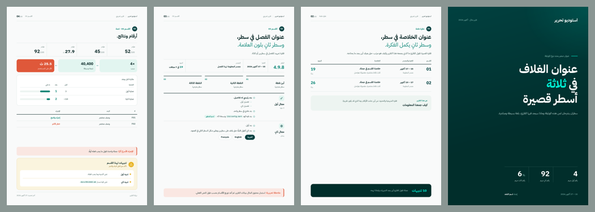

# Editorial PDF

**Arabic-first PDF design skill for AI coding agents.** Compose fixed A4 pages, embed Arabic fonts, and check the rendered layout before delivery.

مهارة لتصميم ملفات PDF عربية مرتبة: صفحات A4 مصممة بعناية، خطوط مضمّنة، وفحص آلي لتجاوز حدود الصفحات.



[Download the sample PDF](sample.pdf) · [Download the skill ZIP](https://github.com/EbrahimAlshaibani/editorial-pdf/archive/refs/heads/main.zip)

## What is included

- A reusable Python/HTML builder and print CSS, with an Arabic four-page component demo.
- Covers, running headers, chapter openers, metadata, ledgers, comparisons and warning boxes.
- Chromium rendering, overflow checks, font-load checks and PDF page-count checks.
- Page PNGs and a contact sheet for visual review.
- IBM Plex Sans Arabic Regular/Bold with its SIL Open Font License.

## Install

Download this repository using **Code → Download ZIP**, extract it, and place the folder containing `SKILL.md` at:

- Codex: `~/.codex/skills/editorial-pdf/`
- Claude Code: `~/.claude/skills/editorial-pdf/`
- Other agents: use their supported local skill directory, or load `SKILL.md` and its supporting files directly.

On Windows, `~` means your user profile folder. The skill does not install its runtime dependencies automatically.

For a Git installation in Codex (run only if the destination does not already exist):

```sh
git clone https://github.com/EbrahimAlshaibani/editorial-pdf.git ~/.codex/skills/editorial-pdf
```

Install Python 3.10+ and dependencies in the Python environment used by the builder:

```sh
python -m pip install -r requirements.txt
python -m playwright install chromium
```

Run these commands from the downloaded repository folder. Restart your agent or refresh skills after installation if needed.

## Use with an agent

```text
Use $editorial-pdf to create an Arabic A4 project report from the following content.
Keep all supplied facts, use the attached brand assets, and inspect every page after rendering.
```

```text
استخدم $editorial-pdf لإعداد تقرير PDF عربي من المحتوى التالي.
حافظ على كل المعلومات، واستخدم هوية المشروع، وافحص جميع الصفحات قبل التسليم.
```

## Run the component demo

From the repository folder:

```sh
python -I assets/build_template.py
```

Outputs: `assets/document.html`, `assets/document.pdf`, and `assets/qa/`. The dates and numbers in the demo are fictional sample content.

For a real document, copy `assets/build_template.py` into your project as `build.py`, edit `BRAND` and the sample pages, and run `python -I build.py`. If the skill is outside the standard directories, set `EDITORIAL_PDF_HOME` to its absolute path:

```sh
# macOS / Linux
export EDITORIAL_PDF_HOME="/absolute/path/to/editorial-pdf"
```

```powershell
# Windows PowerShell
$env:EDITORIAL_PDF_HOME = 'C:\path\to\editorial-pdf'
```

The builder embeds supplied local assets into the HTML. Run builders only from trusted sources and review content before sharing generated documents.

## Verification limits

The checker fails on element overflow, a page-count mismatch, or a missing expected font family. It reports underfilled pages for editorial review. It cannot prove that all glyphs use the intended font, detect every internal overlap, or judge natural Arabic line wrapping. Inspect every page image before calling a document verified.

## License

Original skill instructions, templates and scripts: MIT; see [LICENSE](LICENSE). Bundled IBM Plex Sans Arabic fonts: SIL Open Font License; see [assets/fonts/OFL.txt](assets/fonts/OFL.txt). Runtime dependencies keep their own licenses; in particular PyMuPDF offers AGPL and commercial licensing. No proprietary client fonts, logos or project documents are included.
